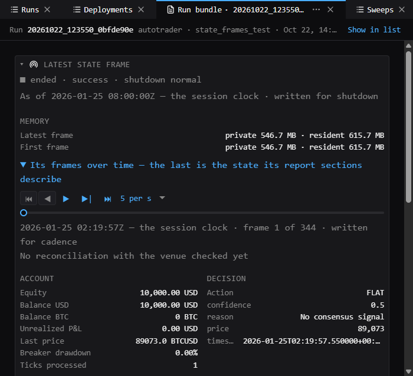
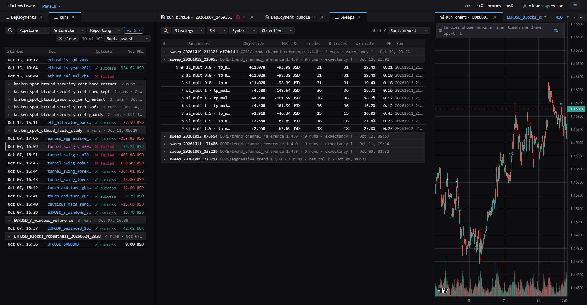

# FiniexViewer

> **Version:** v0.5.0 Pre-Alpha Showcase
> **Status:** v0.5.0 — a deployment as a bundle the way a run is, a session's recorded frames played
> over time, and the run chart's layers: volume, candles in four forms, the levels and entry–exit
> lines of a position, arranged by dragging. 1510 unit tests and a browser suite.

A web-based viewer companion for **[FiniexTestingIDE](https://github.com/dc-deal/FiniexTestingIDE)**.

It reads what a backtest or an AutoTrader session left behind and puts it on one screen: the orders
a strategy submitted and what became of each one, the trades on their candles, the periods the run
was booked into, the warnings a validator raised, and the configuration it all ran under. **Nothing
is recomputed here** — every figure is a field the API served, or it is asked for as one.

Everything is a docked panel: tabs that split side by side, arranged the way an editor's are and
kept across a reload.

## Highlights

### A run, its trades on their candles


The run report is a bundle whose sections open as panels of their own. One scenario in focus narrows
every list, and the run chart beside it draws that scenario's trades where they opened and closed,
the stop loss, the take profit and the entry–exit line of the position looked at, and the volume
behind the candles. The Layers panel shows, fades and orders what the chart draws — by dragging.

### A live bot across its restarts


A deployment opens as a bundle of its sessions and its booking periods. Sessions are separate runs,
so the view says when they are not one series instead of adding them up; where a session changed its
configuration, *before · after* opens both, compared.

### A session over time



A session that records its state frames plays them back: step through them, play them at a chosen
speed, or follow a session that is still recording — its account, its decision and every worker's
output, frame by frame.

### A parameter search, ranked



The Sweeps panel opens each parameter search in the order the backend ranked its combinations by the
objective it declared, and one click makes a combination the run on show.

### And more

- **Find a run by what it did** — a facet bar on one line narrows the run list by pipeline, outcome,
  set or time; a sweep's combinations and a deployment's sessions fold under one heading.
- **What runs on the machine** — the Activities panel lists what FiniexTestingIDE is running, each
  beneath the one it runs inside, with the memory it holds.
- **A warning says where it came from** — headed by the title of the validation check that decided it.
- **Every control explains itself** in a hint that can be dismissed, in a dark and a light theme.

---

## What This Is

- A **separate repository** that talks to FiniexTestingIDE over HTTP — no shared filesystem.
- A **Vue 3 / TypeScript / Vite** single-page application, dark mode by default.
- A **read-only viewer** — candle chart, run reports, and a live bot's history across its restarts. No trade execution, no scenario control.
- **Nothing is derived here.** A figure a panel shows is a field the API served. Where one would have to be computed, that is a request to the backend rather than three lines of arithmetic with a second source of truth.

## What This Is Not

- Not a trading platform or execution UI.
- Not a strategy runner — no simulation control from the browser.
- No login, no user accounts, no multi-user setup.
- Not a replacement for the FiniexTestingIDE CLI.

---

## Getting Started

### Prerequisites

- **FiniexTestingIDE** cloned and its API server running — FiniexViewer has no data of its own.
- **Node.js 18+** and **npm**.

### Setup

```bash
git clone https://github.com/dc-deal/FiniexViewer.git
cd FiniexViewer
npm install
```

Create `.env.local` to point at your API server (default is `http://localhost:8000` — skip if that matches):

```bash
echo "VITE_API_BASE_URL=http://localhost:8000" > .env.local
```

If the API requires a bearer token, put it in the same file:

```bash
echo "FINIEX_API_TOKEN=<your token>" >> .env.local
```

**Note the missing `VITE_` prefix, and do not add one.** A `VITE_*` variable is inlined into the
browser bundle at build time, which would publish the token to anyone who opens the page. This one
is read by the dev proxy and attached to the outgoing request, so the browser never receives it.
Leave it unset and no `Authorization` header is sent.

### Run

```bash
# Start the FiniexTestingIDE API server first:
python python/cli/api_server_cli.py --reload   # inside FiniexTestingIDE

# Then start the Vite dev server:
npm run dev
```

Open **[http://localhost:5173](http://localhost:5173)**.

### Docker Compose (dual-repo setup)

If you use the FiniexTestingIDE devcontainer, the dual-container setup is documented in [FiniexTestingIDE — FiniexViewer Setup Guide](https://github.com/dc-deal/FiniexTestingIDE/blob/main/docs/user_guides/finiexviewer_setup.md).

---

## Tech Stack

| Layer | Choice |
|---|---|
| Build tool | **Vite 6** |
| Framework | **Vue 3** — Composition API, `<script setup>` |
| Language | **TypeScript** |
| State | **Pinia** |
| Docking | **dockview** — tabbed, docked panels; floating switched off |
| Charts | **Lightweight Charts** (TradingView) |
| HTTP client | **axios** |
| Layout | **vue-draggable-plus** for the order of the run report's sections and of the chart's layers |
| Headless components | **Reka UI** — collapsible, dropdown menus, dialog, popover, hover card, tooltip |
| Icons | **Tabler Icons** — drawn by meaning through one registry |
| Theme | CSS Custom Properties token system, dark/light mode |
| Linting | **ESLint 9** + `eslint-plugin-vue` + `@vue/eslint-config-typescript` + `@stylistic` |
| Dead code | **knip** — unreferenced files, exports and dependencies |
| Testing | **Vitest** + **Vue Test Utils** — unit tests, jsdom environment |
| Browser tests | **Playwright** — a real reload, real storage, real geometry; hygiene rather than a gate |
| CI | **GitHub Actions** — type-check + tests on every PR and push to master |

Every document, one line on what each answers: [docs/documentation_index.md](docs/documentation_index.md) · the words this viewer coins: [docs/glossary.md](docs/glossary.md)

---

## Architecture

```
┌─────────────────────────┐        HTTP / REST        ┌──────────────────────────┐
│     FiniexViewer        │ ◄───────────────────────► │   FiniexTestingIDE       │
│  (Vue 3, TypeScript)    │     /api/v1/brokers/...    │   (Python, FastAPI)      │
│                         │                            │                          │
│  - Docked panels        │                            │  - Parquet tick reader   │
│  - Run report bundle    │                            │  - Bar index manager     │
│  - Run chart, free chart│                            │  - Scenario engine       │
│  - Deployment bundle    │                            │  - Run-results ledger    │
│  - Restored arrangement │                            │                          │
└─────────────────────────┘                            └──────────────────────────┘
```

Two-container topology and request flow: [docs/architecture/container_topology.md](docs/architecture/container_topology.md)

---

## Development Commands

```bash
npm run dev          # start Vite dev server
npm run build        # production build
npm run type-check   # TypeScript check without emit
npm run lint         # ESLint with autofix (lint:check to only report)
npm run knip         # report unreferenced files, exports and dependencies
npm run test         # run unit tests (Vitest)
npm run test:coverage  # run tests with coverage report
npm run preview      # serve the production build
npm run test:e2e     # browser suite (needs a browser; see below)
```

The browser suite needs a browser, and the container has none — the image is Alpine on musl while
Playwright's browsers are glibc builds. One script does the whole procedure, including killing the
browser afterwards whatever happened:

```bash
bash scripts/e2e.sh                 # the whole suite
bash scripts/e2e.sh e2e/one.spec.ts --workers=1
```

---

## Contributing

How a change is made here — what it carries, the checks it passes, and the UI building blocks every
screen is drawn from: [CONTRIBUTING.md](CONTRIBUTING.md).

## License

MIT — see [LICENSE](LICENSE).

## Disclaimer

Pre-release alpha under active development. Features, APIs, and architecture may change without notice. Provided as-is for research and educational purposes. Nothing in this project constitutes financial advice.
